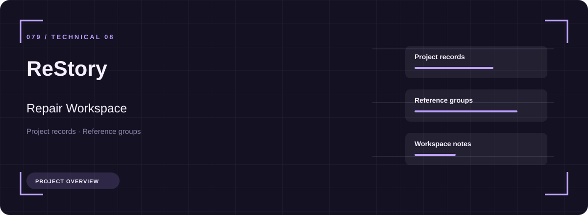
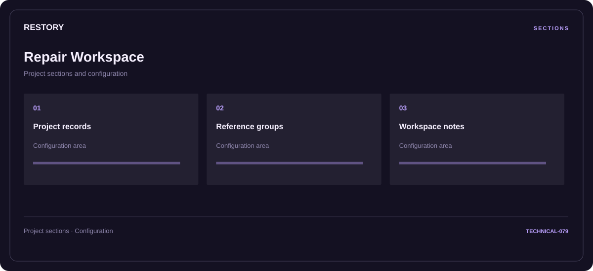

# 🧭 ReStory Repair Workspace

**Project records · Reference groups · Workspace notes**

## ⚡ Features

Project records, reference groups, and workspace notes form the core of ReStory Repair Workspace. Related configuration is grouped by task rather than collected in an undifferentiated list.

### ⚙️ Project records

A dedicated section for project records and the configuration details associated with that area.

### 🧩 Reference groups

A dedicated section for reference groups and the configuration details associated with that area.

### ⌨️ Workspace notes

A dedicated section for workspace notes and the configuration details associated with that area.

## 🖥️ Project navigation

## 📥 Download

The button and cover open the project's download page. Use the information supplied with the downloaded package for installation and release-specific requirements.

## 📚 Project documentation

- [Feature reference](docs/FEATURES.md)
- [Download information](docs/DOWNLOAD.md)
- [Project page](index.html)

---

ReStory Repair Workspace · Program documentation and download information.
